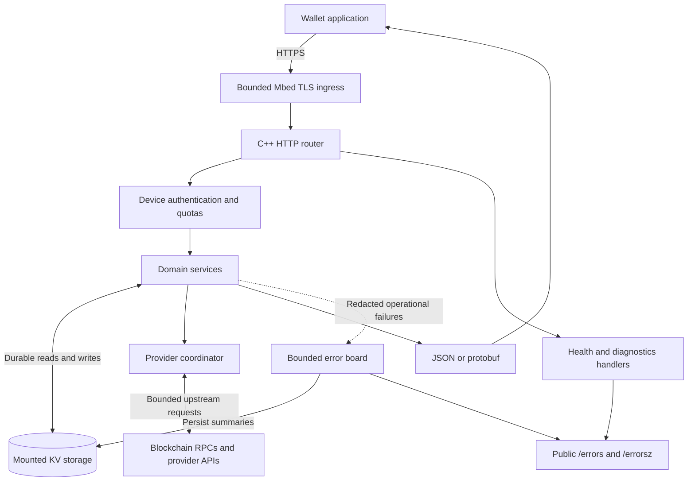
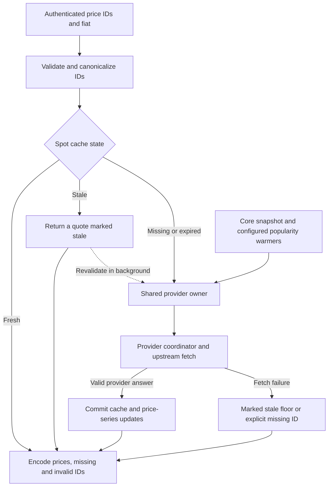
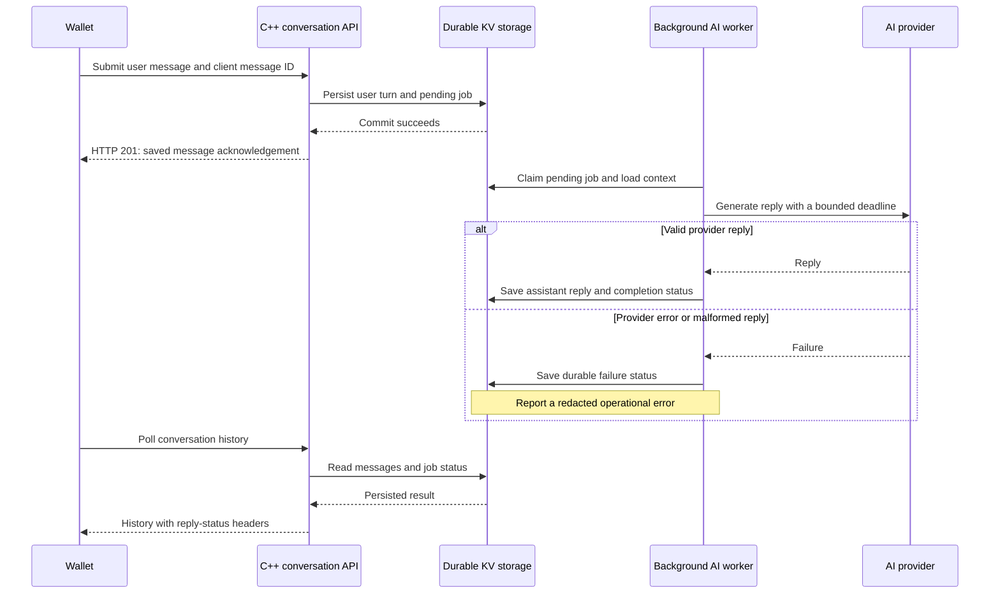

[](https://fortisnet.io)

> *People and AI agents will work across borders, services and networks.
> They need a shared foundation for identity, resources, value and
> verifiable results. FortisNet is building toward that foundation.*

# FortisNet Node

The server that FortisNet wallets and applications connect to: one static
C++23 program with its own HTTPS, storage and device authentication. It
serves prices, token and address views across many blockchains, wallet
synchronization, news and asynchronous AI conversations.

[](LICENSE)

> **Status: early.** The node runs and is tested, but it is a development
> release: production device attestation is not yet validated, and there is
> no numbered release. Expect changes. See
> [What is not done yet](#what-is-not-done-yet).

**To run a node, you do not build this repository.** Use
[FortisNet Node OS](https://github.com/FortisNet/node-os): a disk image and
container images that install, update and recover the node for you. This
repository is for people who want to read, build or change the node itself.

## How the two repositories fit together

| Repository | What it is |
| --- | --- |
| **FortisNet/node** (this one) | The node program: the API, storage, providers, authentication |
| [FortisNet/node-os](https://github.com/FortisNet/node-os) | The system around it: images, the orchestrator that installs and updates the node, certificates, signed releases |

A release of the node is a single static executable for x86-64 and one for
ARM64, each with a manifest that names its hash. Node OS signs the manifest,
puts the release into its images and verifies it again on every host before
running it. [docs/node-updates.md](docs/node-updates.md) describes the
node's side of that.

## Quick start

You need a C++23 compiler, `make`, Python 3, Node.js 25.9 and npm. Clang 18
with libc++ and GCC 13 with libstdc++ are the verified Linux toolchains;
Apple Clang works for development on macOS.

```sh
npm ci --omit=optional          # tools for the generators and tests; not part of the server
make -j4
mkdir -p data
FORTIS_KV_DIR="$PWD/data" NODE_ENV=development ./build/fortis_node 8080
```

In another terminal:

```sh
curl --fail http://127.0.0.1:8080/healthz
curl --fail http://127.0.0.1:8080/statusz
```

Open `http://127.0.0.1:8080/` for the node's home page, `/dashboard` for
live measurements and `/doc` for the API reference. The price, AI and other
service routes are switched on by their own settings
([Configuration](#configuration)); once on, a protected route such as
`/v1/prices` answers 401 without a device credential.

Never commit `.env` files, provider keys, device credentials, stores or
backups. Use a data directory of its own for development: a lock stops two
processes from opening the same store.

## What the node does

| Area | What it provides |
| --- | --- |
| **Prices** | Spot prices, history and OHLC for coins and tokens, cached and shared between clients. A price that cannot be obtained is reported as missing, never as zero |
| **Tokens and addresses** | Token pages, search, balances, transfers and transactions across the supported networks |
| **Wallet synchronization** | Durable, device-authenticated synchronization of wallet state |
| **News and media** | A feed assembled from public sources, with reactions |
| **AI conversations** | Messages are saved first and answered in the background; a reply survives a restart |
| **Devices** | Enrollment, key rotation and revocation, with Apple and Android attestation |
| **Operations** | Health, status, a public error board, a dashboard and metrics, all without third-party scripts |

The API is described by [contracts/openapi.base.yaml](contracts/openapi.base.yaml),
[openapi.native.yaml](openapi.native.yaml) and the schemas in
[proto/schema/](proto/schema). The node serves the compiled reference at
`/doc`.

## Architecture

| Component | Responsibility |
| --- | --- |
| `src/app` | Configuration, dependency composition, worker ownership and ordered shutdown |
| `src/http`, `src/codec` | Bounded HTTP/HTTPS, JSON and protobuf serialization |
| `src/storage` | Checksummed append-only KV transactions, recovery, expiry and compaction |
| `src/auth` | Device enrollment, rotation, revocation and attestation |
| `src/networks`, `src/chains`, `src/wallet` | Network catalog, chain adapters, address views and wallet synchronization |
| `src/providers`, `src/prices` | Shared upstream pacing, coalescing, spot/history caches and coverage |
| `src/discovery`, `src/tokens` | Market discovery and token views |
| `src/news`, `src/ai`, `src/exchange` | News/media, durable AI jobs and exchange integrations |
| `src/operations` | Health, metrics, public status/error pages and diagnostic persistence |
| `src/base`, `src/compat`, `src/crypto` | Ownership, concurrency, compatibility contracts and cryptographic glue |
| `contracts`, `proto/schema` | Project-owned generator inputs and wire schemas |
| `tests`, `scripts` | Native units, independent replays, analysis and build/deployment tools |


[sources.mk](sources.mk) lists every source file and the component it
belongs to. Dependencies between components go one way, and
`make check-layers` enforces it. [docs/architecture.md](docs/architecture.md)
describes the design in full.

### A request




### A price

Fresh cache entries avoid an upstream request. Stale entries can be served with
an explicit stale flag while a shared refresh runs. Cold or expired entries use
bounded provider work; failures preserve explicit missing/stale semantics.




### An AI reply

HTTP 201 acknowledges a persisted user turn and pending work. The wallet reads
history to observe the eventual assistant reply or a durable failure status.
Pending work can recover after a restart.




## How it is kept safe

- **Bounded everywhere.** Requests, responses, queues, caches and upstream
  calls all have explicit limits; the HTTP and TLS code is the node's own
  and small enough to test exhaustively.
- **Devices are authenticated.** Protected routes need a credential issued
  at enrollment; quotas apply per device.
- **Storage that survives a crash.** Checksummed, append-only transactions
  with recovery, expiry and compaction.
- **Errors are public, data is not.** `/errors` shows stable codes and
  counts. It never shows wallet contents, AI messages, credentials or raw
  upstream answers.
- **Hardened static builds.** A release is one static, position-independent
  program; the compiler flags of every source file are audited before a
  release is accepted.
- **Run without privileges.** Node OS runs the node as an ordinary user in
  its own container, with a read-only filesystem and a system call filter.

To report a vulnerability, see [SECURITY.md](SECURITY.md).

## Verifying a change

```sh
make verify
```

This is the gate, and it runs in a container it builds itself, so Docker
must be running. It builds with Clang and GCC with warnings as errors, runs
the Clang Static Analyzer, clang-tidy and Cppcheck, then every unit test
with both compilers and the HTTP and TLS replays. The result is
`build-verify/report.json`: every stage must pass and `inputs_unchanged`
must be true. `make lean-verify` is a quicker subset for small changes.
[docs/verification.md](docs/verification.md) has the details, and
[docs/sanitizers.md](docs/sanitizers.md) the sanitizer builds.

This repository has no hosted pipeline of its own: the gate is run by the
person making a change, and its report is what a reviewer asks for.

## Building a release

```sh
make native-release VERSION=1.2.3     # static programs for x86-64 and ARM64, into dist/native-releases/1.2.3/
```

A release can only be built from files with a passing gate report. It is
handed to Node OS to be signed and published
([how](https://github.com/FortisNet/node-os/blob/main/docs/releasing.md#the-node-release-inside-the-images)).
[docs/native-runtime.md](docs/native-runtime.md) describes the release
build and what the node expects from its host.

## Configuration

Settings are environment variables, validated at start in
[src/config/native_config.cpp](src/config/native_config.cpp). The most
important:

| Setting | Purpose |
| --- | --- |
| `FORTIS_KV_DIR` | Directory of the persistent store |
| `NODE_ENV`, `ATTESTATION_MODE` | Deployment mode and the device attestation policy |
| `FORTIS_ANDROID_ATTESTATION_REQUIRED`, `FORTIS_APPLE_ATTESTATION_REQUIRED`, `FORTIS_DESKTOP_ATTESTATION_REQUIRED` | Require attestation for each platform. Off by default |
| `FORTIS_NATIVE_PRICE_ROUTE_CANARY=1` | Enable the price and discovery routes |
| `FORTIS_PRICE_SNAPSHOT_ENABLED=1` | Enable the shared price snapshot for default wallets |
| `FORTIS_SPLIT_PRICE_STORE=1` | Keep prices in a store of their own |
| `FORTIS_CA_BUNDLE_PATH` | Trusted certificate authorities for upstream calls |
| `FORTIS_COINGECKO_API_KEY_FILE`, `COINGECKO_TIER` | Price provider credential file and tier |
| `FORTIS_NATIVE_AI_CANARY=1` | Enable AI conversations, with their own settings |

Use `/healthz` for process health, `/statusz` for a summary and `/errors`
for public failures. Provider key files, and any backup that contains them,
are secrets.

## Documentation

| | |
| --- | --- |
| [docs/architecture.md](docs/architecture.md) | The design: components, request flow, storage, providers, boundaries |
| [docs/object-model.md](docs/object-model.md) | Ownership, lifetimes and concurrency of the main objects |
| [docs/cpp-standards.md](docs/cpp-standards.md) | The C++ conventions the code keeps |
| [docs/verification.md](docs/verification.md) | The gate, stage by stage |
| [docs/native-https.md](docs/native-https.md) | The node's own HTTPS |
| [docs/native-runtime.md](docs/native-runtime.md) | Release builds and what the node expects from its host |
| [docs/node-updates.md](docs/node-updates.md) | How a running node is updated |
| [docs/error-reporting.md](docs/error-reporting.md) | What the public error board shows, and what it never shows |
| [docs/compat-decisions.md](docs/compat-decisions.md) | Compatibility decisions the API keeps |
| [docs/](docs) | Everything else: prices, storage, dashboard, budgets |

## What is not done yet

- **Production attestation.** Apple and Android attestation are implemented
  but not yet validated on production devices; development enrollment is
  what runs today.
- **A hosted pipeline.** The gate runs on the contributor's computer, and
  releases are built there too. Building releases on GitHub is the next
  step, so that the node is built in public like Node OS.
- **A numbered release.** Versions are commit hashes for now.
- **Tests of the news pipeline against recorded feeds.** They used recorded
  publisher content and were not published with the code; synthetic
  replacements are to be written.
- **Leftovers of a second build.** The same sources also build as a
  Unikraft unikernel. That build's files are not published yet, so the
  `FORTIS_UNIKRAFT` branches and a few guest-only sources are unused here.
- **Expected values from an earlier implementation.** The node reproduces
  the behaviour of an earlier TypeScript service, and many tests record
  that service's answers. It is not part of this repository.

## Contributing

Changes are welcome. [CONTRIBUTING.md](CONTRIBUTING.md) explains how to
build, what the gate checks and what a change needs before it can be
merged, and [GOVERNANCE.md](GOVERNANCE.md) who decides. Please read the
[code of conduct](CODE_OF_CONDUCT.md).

## License

[Apache License 2.0](LICENSE). Third-party code and its licenses are listed
in [THIRD_PARTY_NOTICES.md](THIRD_PARTY_NOTICES.md).

---

[FortisNet](https://fortisnet.io) | [Blockchain](https://blockchain.fortisnet.io) | [XFN](https://token.fortisnet.io) | [Wallet](https://wallet.fortisnet.io)
