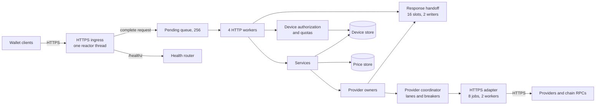
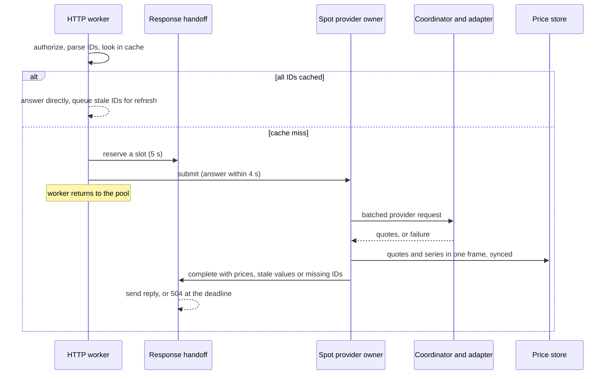
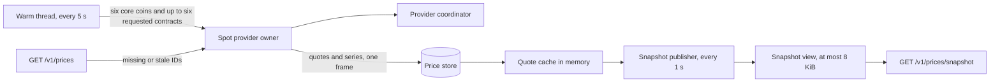

# FortisNet Node architecture

This document describes how the node is built: what the program is, its components, how a request flows through it, how it stores data, which outside services it calls, where its security boundaries are and what it expects from its host. Read it before changing code that crosses component boundaries or before deciding how to run the node.

Numbers in this document are compile-time constants in the source unless stated otherwise. The named file is the place to check them.

## 1. The program

The node is one C++23 program, `build/fortis_node`. A release build is a static Linux executable named `fortis-node` for x86-64 or ARM64 ([docs/native-runtime.md](native-runtime.md)). It is the backend of the FortisNet wallet. One process contains:

- an HTTP/1.1 server, with optional built-in TLS;
- a device API: enrollment, credential rotation and revocation, attestation and quotas;
- market data: spot prices, a shared price snapshot, price history, OHLC and market discovery;
- blockchain adapters, address views, token views and wallet synchronization;
- news and media, durable asynchronous AI conversations and exchange integrations;
- an embedded durable key-value store;
- public status, error and release pages.

There is no separate database server, message broker or reverse proxy. The process owns its data directory exclusively.

Optional services start only when their startup switch is set (`FORTIS_NATIVE_PRICE_ROUTE_CANARY`, `FORTIS_NATIVE_NEWS_CANARY`, `FORTIS_NATIVE_ADDRESS_CANARY`, `FORTIS_NATIVE_AI_CANARY`, `FORTIS_NATIVE_CROSS_CHAIN_CANARY`, `FORTIS_NATIVE_ROBINHOOD_CANARY`, `FORTIS_NATIVE_DASHPAY_CANARY`). A service that is not enabled registers no routes and starts no threads. [src/config/native_config.h](../src/config/native_config.h) documents every setting.

The API contract is defined by [contracts/openapi.base.yaml](../contracts/openapi.base.yaml), [openapi.native.yaml](../openapi.native.yaml) and the protobuf schemas under [proto/schema](../proto/schema). The running node serves the compiled reference at `/doc`.

## 2. Components

Each directory under `src/` is one component. [sources.mk](../sources.mk) lists every source file, and `make check-layers` fails when a component depends on one it must not.

| Component | Responsibility |
| --- | --- |
| `src/app` | Entry point, configuration slices, composition of all services, the HTTP and HTTPS listeners, the worker pool and ordered shutdown |
| `src/config` | Reading and validating the environment at startup |
| `src/http` | Request parsing, the router, response writing, the response handoff and the outbound HTTPS client |
| `src/codec` | Bounded JSON, protobuf wire encoding and other wire formats, and the node's rules for cleaning and truncating provider text |
| `src/storage` | The key-value store: log, index, recovery, commit, compaction, expiry and in-memory quota counters |
| `src/auth` | Device challenges, enrollment, rotation, revocation, Apple App Attest and Google Play Integrity |
| `src/providers` | Provider lanes, the execution coordinator and the price provider clients |
| `src/prices` | Spot cache, spot resolution, snapshot, history, OHLC and their routes |
| `src/discovery` | Market discovery, coin popularity, token search and media registry |
| `src/networks` | The network catalog and token references |
| `src/chains` | One driver per chain family and the JSON-RPC transport |
| `src/wallet` | Address views, transfers and wallet synchronization |
| `src/tokens` | Token facts, token pages, comparisons and their background jobs |
| `src/news` | News ingest, storage and routes, and media |
| `src/ai` | AI conversations, the durable job worker and usage statistics |
| `src/exchange` | Cross-chain quotes, tokenized stocks and Dash payments |
| `src/operations` | Health, metrics, telemetry, the error board, dashboards, release pages and the sandbox control client |
| `src/base` | Ownership, threading, clocks, logging, status types and exception boundaries |
| `src/security` | The scanner that removes secrets from public error reports and AI text |
| `src/compat` | Behavior that must match the wallet's expectations exactly: case mapping, date parsing, regular expressions, URL and IDNA handling |
| `src/crypto` | Build glue for Mbed TLS, BLAKE3 and blst |

`src/app` is the composition root. It creates each service, gives it borrowed references to the stores and transports it needs, and owns every thread. A consumer never outlives what it borrows: shutdown stops and joins workers before it releases a store or a transport.

## 3. Process structure



Startup runs in a fixed order ([src/app/server.cpp](../src/app/server.cpp)): load and validate configuration, open the store, start the provider coordinator and every enabled service, bind the listener, start the response handoff, register routes, start the store sweepers, start the HTTP workers and the history sampler, start the health listener, then serve. A failure at any step stops what has started and exits; the node never serves a partial set of routes.

Shutdown runs on `SIGTERM` or `SIGINT` in the opposite order ([src/app/application.cpp](../src/app/application.cpp)): close the listener, stop health, join the HTTP workers, stop the sampler and sweepers, stop service owners, stop the coordinator, stop the handoff, close the store.

## 4. How a request flows

### 4.1 Ingress

The node has two ingress modes.

- **Built-in HTTPS.** When `FORTIS_HTTPS_CERT_DIR` is set, one nonblocking reactor thread accepts connections, performs TLS handshakes with Mbed TLS and reads each request completely before any worker sees it. It limits connections, handshakes, uploads and request rate per client address. A second port serves ACME challenge files and redirects to HTTPS. See [docs/native-https.md](native-https.md).
- **Plain HTTP.** Without that variable, the main thread accepts connections and queues the sockets. This mode is for development and tests, or for a private listener behind another TLS endpoint.

The listening sockets are either bound by the node or passed in already open by the host through `FORTIS_LISTEN_FDS` ([src/app/http_listener.h](../src/app/http_listener.h)).

### 4.2 Admission and dispatch

- Accepted work waits in a ring of 256 entries (`kPendingConnectionCapacity`). When the ring is full the node answers `503` without parsing.
- Four worker threads (`kHttpWorkerCount`) take entries in order. An entry that has waited one second or longer gets a `503` with `Retry-After: 1` before parsing.
- A request has at most 16 KiB of headers, a 512 KiB body and a 12,500-byte target, and three seconds to arrive on a plain connection ([src/http/http_request.h](../src/http/http_request.h)).
- The router holds at most 96 routes. Registration fails at startup if a route cannot be added.

### 4.3 The route lock

A handler runs under one process-wide mutex, `route_state_mutex`, unless its route is on an audited list of exemptions in [src/http/http_server.cpp](../src/http/http_server.cpp). Exempt routes own all the state they touch or lock it themselves. They include health, device enrollment, rotation and revocation, the network catalog, spot prices, the price snapshot and the AI history read. Each exemption carries a comment that states the audit. A new route is locked by default.

A locked handler writes its response into a capture buffer (512 bytes inline, at most 2 MiB on the heap). The node sends the bytes after it releases the lock, so a slow client cannot hold the lock.

### 4.4 Authorization

Protected `/v1` routes require a device credential, which a device obtains through the challenge and enrollment routes ([src/auth/device_enrollment.cpp](../src/auth/device_enrollment.cpp), [src/auth/device_auth.cpp](../src/auth/device_auth.cpp)).

1. A request with an `Origin` header is refused with `403`. The API is for applications, not browsers.
2. The bearer token is hashed and looked up in the device store. Only the hash is stored.
3. Expiry and the attestation policy are checked.
4. The route's cost is charged to the device's per-minute quota. Over the limit, the answer is `429`.

Authorization runs before the service does any work. [docs/device-workload-contract.md](device-workload-contract.md) lists the exact status codes and limits.

### 4.5 Response handoff

A handler that must wait for a provider does not keep its worker. It reserves one of 16 handoff slots with a deadline of at most 30 seconds, passes the socket to the handoff and returns ([src/http/http_server.h](../src/http/http_server.h)). The service completes the slot later with a body. Two writer threads send completed slots, send `504` when a deadline passes and free the slots of clients that disconnect.

### 4.6 A spot price request



Concurrent requests for the same IDs share one provider request. When a slot, the handoff or the owner refuses work, the route answers from stale cached values if it has them and otherwise returns `503`. A price that no provider supplies is listed as missing. It is never reported as zero.

## 5. Storage

The store is an embedded, single-process key-value store ([src/storage/kv_store.h](../src/storage/kv_store.h)).

- **Format.** An append-only log of checksummed frames. A frame holds one or more mutations and is applied completely or not at all. An in-memory AVL index maps keys to positions in the file. Values stay on disk.
- **Ownership.** The process takes an exclusive `flock` on the store. A second process cannot open it.
- **Durability.** A write is acknowledged after the frame is synced and the index is updated. The default protocol records the last confirmed offset in a marker file around each append. An optional protocol keeps commit pointers inside the log (`FORTIS_KV_DURABILITY=commit-slots`). [docs/kv-capacity.md](kv-capacity.md) describes both.
- **Concurrency.** One mutex per store serializes reads, writes, scans and maintenance. Conditional writes (`CompareAndWrite`) check expected values of at most 4,096 bytes and write in the same frame. Optional group commit puts concurrent writers in one frame ([docs/kv-group-commit.md](kv-group-commit.md)).
- **Recovery.** At startup the store replays the log and discards a torn tail. After an I/O error on a write the store refuses access until a bounded replay succeeds. While it is closed, authorization returns `500` and `/healthz` reports unhealthy.
- **Maintenance.** A sweeper thread per store runs every 10 seconds by default. It removes at most 256 expired rows per pass and runs bounded compaction slices. Compaction is skipped when free disk space is low.

The node keeps one or two stores under the data directory (`FORTIS_KV_DIR`):

| Store | Contents |
| --- | --- |
| Device store | Devices, credentials and challenges, and by default all other service data: AI conversations, news, wallet synchronization, token facts, error summaries |
| `prices-v1` | Spot quotes, quote metadata, price series. Created when `FORTIS_SPLIT_PRICE_STORE=1` ([docs/price-memory-store.md](price-memory-store.md)) |

The two stores have separate locks, sweepers, recovery and compaction. Splitting them keeps price writes from delaying device authorization.

State that does not need to survive a restart lives in bounded memory: per-device and per-address quota counters (16,384 slots), the authorization cache for price reads (4,096 slots, 30-second lifetime), the spot quote cache (4,096 slots), request telemetry and the handoff.

Invariants that changes must keep:

- A device challenge is consumed in the same frame that creates the device.
- Rotation removes the old credential hash and writes the new one in one conditional frame. Exactly one of two concurrent rotations succeeds.
- Revocation is a conditional write.
- A price batch and its series are written in one frame.
- After an ambiguous I/O error, replay decides what the log contains. A client whose response was lost must reconcile.

## 6. External providers

All outbound traffic is HTTPS through one client ([src/http/outbound_https.cpp](../src/http/outbound_https.cpp)). It verifies certificates against the bundle named by `FORTIS_CA_BUNDLE_PATH`, connects only to public addresses, bounds request and response sizes (2 MiB and 4 MiB at most, lower per operation) and does not follow redirects.

Provider work goes through three layers ([src/providers](../src/providers)):

1. **Lanes.** Each provider has a lane with a request rate, a burst, a concurrency limit, a bounded queue and a circuit breaker ([src/providers/provider_lane.cpp](../src/providers/provider_lane.cpp)). For example, the CoinGecko lane allows 24 requests a minute with two in flight. A `429` from a provider opens its breaker.
2. **Coordinator.** One thread owns the lane registry and admits work from service owners.
3. **Adapter.** Eight preallocated jobs and two TLS worker threads perform the requests, with at most three attempts each.

The node calls these kinds of provider:

| Kind | Providers |
| --- | --- |
| Prices | CoinGecko (primary), Kraken, DefiLlama, MEXC, Jupiter, Vestige, TronScan, Robinhood |
| Chains and explorers | JSON-RPC endpoints and indexers for the supported chain families (EVM, Solana, UTXO, Tron, Cosmos, Cardano, Stellar, XRPL, Algorand, Hedera, NEAR, Aptos, Sui, ICP, VeChain, Bittensor) |
| Exchange | Cross-chain aggregators and bridges, Robinhood, Dash |
| AI | Anthropic Messages API |
| Attestation | Google Play Integrity. Apple App Attest is verified locally |
| News | Publisher feeds and registered media hosts |

Provider credentials come from environment variables or key files. They are optional for most providers. A provider that is unavailable makes its data missing or stale; it does not fail unrelated routes. [docs/price-provider-fallback.md](price-provider-fallback.md) describes how spot prices fall back between providers.

### Price refresh



Foreground requests and background refresh share the same owner, lanes and deadlines. [docs/price-snapshot.md](price-snapshot.md) describes the snapshot.

## 7. Threads and bounded memory

On Linux the kernel schedules the node's threads across the available cores. The pools are fixed at compile time:

| Stage | Threads | Bound |
| --- | --- | --- |
| HTTPS ingress | 1 reactor | 256 connections, 32 handshakes |
| Request handling | 4 workers, 256 KiB stacks | 256 queued requests |
| Response handoff | 2 writers | 16 slots, at most 2 MiB each |
| Health | 1 | one connection at a time |
| Spot prices | 1 owner (1 MiB stack), 1 warm thread, 1 snapshot publisher | 8 owner requests |
| Provider execution | 1 coordinator, 2 adapter workers, at most 4 resolver threads | 8 jobs, 12 owners |
| Store maintenance | 1 sweeper per store | 256 rows per pass |
| Other services | their own owner, worker and scheduler threads | per-service queues |

Every queue, table and buffer has a fixed capacity. When one is full the node refuses new work with an explicit status instead of growing. [docs/resource-budgets.md](resource-budgets.md) lists the budgets and how release builds check stack frames.

## 8. Observability

| Route | Content |
| --- | --- |
| `/healthz` | Process health, including a read of the device store |
| `/statusz`, `/statsz` | Aggregate status and per-route request statistics as JSON |
| `/metrics` | Prometheus text. Requires the bearer token set in `METRICS_TOKEN` |
| `/dashboard`, `/stats` | Resource and request charts ([docs/node-dashboard.md](node-dashboard.md)) |
| `/errors`, `/errorsz` | Redacted error summaries ([docs/error-reporting.md](error-reporting.md)) |
| `/releases`, `/releasesz` | Release identity and history supplied by the host ([docs/node-updates.md](node-updates.md)) |
| `/` | Home page and service list ([docs/node-home.md](node-home.md)) |

Health has its own listener when `FORTIS_HEALTH_PORT` is set, with one thread and its own socket queue. It does not use the worker pool, so a full request queue does not hide the node from its supervisor. Health still reads the device store and waits for that store's mutex.

Public pages publish aggregates only. They never include credentials, device identifiers, wallet contents, AI messages or raw provider responses.

## 9. Security boundaries

- **Network input.** Every parser is bounded: headers, bodies, targets, JSON size and token count, protobuf fields. Ambiguous framing is refused. With built-in HTTPS, the reactor refuses unknown hosts, alternate path spellings and the whole `/probe` namespace before routing.
- **Clients.** A device credential is a random bearer token. The node stores only its SHA-256 hash. Tokens expire (one hour by default) and are replaced by rotation. Attestation policy is set per platform by `ATTESTATION_MODE` and the `FORTIS_*_ATTESTATION_REQUIRED` variables. Development enrollment is accepted only from loopback and private addresses, and the node does not trust forwarding headers to decide that.
- **Browsers.** Requests with an `Origin` header are refused on `/v1`.
- **Providers.** Responses are untrusted input: size-bounded, strictly parsed and validated for freshness before use. Keys are never placed in URLs or logs.
- **AI.** The wallet snapshot attached to a conversation is passed to the model as data. The instructions tell the model not to follow instructions found inside it ([docs/ai-message-attachment.md](ai-message-attachment.md)).
- **Diagnostics.** Unauthenticated diagnostic probes are registered only when `FORTIS_ENABLE_DIAGNOSTIC_PROBES=1`. Keep that listener private.
- **The process.** The node needs no privileges. It does not start other programs, load code at run time or update itself. Release builds are static, position-independent executables with stack protection, fortified libc calls, read-only relocations and a non-executable stack.
- **Sandboxed workloads.** The node can ask a separate root-owned broker to run a job in a gVisor sandbox through an authenticated local socket. It has no public route for this ([docs/sandbox-control.md](sandbox-control.md)).

## 10. What the node expects from its host

The node is a single unprivileged process. Its host supplies the following.

| Need | How the node receives it |
| --- | --- |
| A writable data directory on durable storage, used by no other process | `FORTIS_KV_DIR` |
| Listening sockets | A port argument or `PORT`, or open descriptors named in `FORTIS_LISTEN_FDS` |
| A CA bundle for outbound TLS | `FORTIS_CA_BUNDLE_PATH` |
| Certificates for built-in HTTPS, and a signal after renewal | `FORTIS_HTTPS_CERT_DIR`, `SIGHUP` |
| A directory of ACME challenge files | `FORTIS_ACME_CHALLENGE_DIR` |
| Provider keys | Environment variables or private key files |
| Release and health reports to publish | Read-only files in `FORTIS_RELEASE_STATUS_DIR` (default `/deployment`) |
| A supervisor | Restart on exit; send `SIGTERM` to stop; poll `/healthz` |
| Outbound network access and DNS | Operating system |

The node does not install or update itself, obtain certificates, back up its store or restart after a crash. [FortisNet Node OS](https://github.com/FortisNet/node-os) does those jobs: it builds a disk image and container images, and its orchestrator installs, updates, watches and recovers the node, obtains the HTTPS certificate and runs the node unprivileged in its own container.

For local development none of that is needed:

```sh
make -j4
mkdir -p data
FORTIS_KV_DIR="$PWD/data" NODE_ENV=development ./build/fortis_node 8080
```

Some sources contain conditional code for a Unikraft guest build (`FORTIS_UNIKRAFT`). The guest build files are not part of this repository.

## 11. Further reading

| Topic | Document |
| --- | --- |
| HTTPS ingress | [docs/native-https.md](native-https.md) |
| Release build and runtime contract | [docs/native-runtime.md](native-runtime.md) |
| Resource budgets | [docs/resource-budgets.md](resource-budgets.md) |
| Store capacity and durability | [docs/kv-capacity.md](kv-capacity.md), [docs/kv-group-commit.md](kv-group-commit.md) |
| Prices | [docs/price-snapshot.md](price-snapshot.md), [docs/price-memory-store.md](price-memory-store.md), [docs/price-performance-audit.md](price-performance-audit.md), [docs/price-provider-fallback.md](price-provider-fallback.md) |
| Coding rules and verification | [docs/cpp-standards.md](cpp-standards.md), [docs/verification.md](verification.md) |
