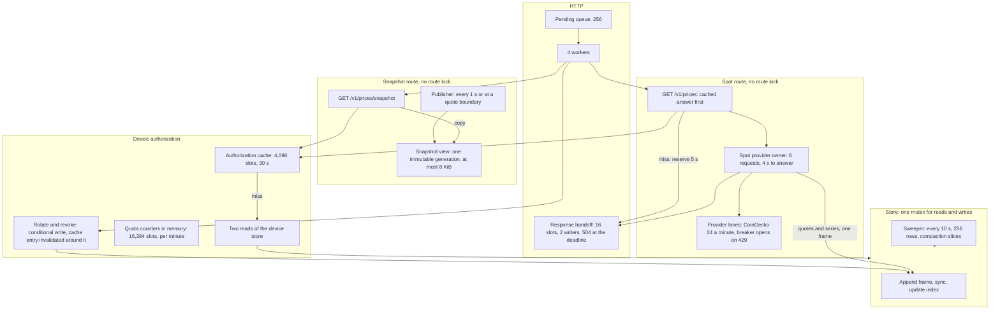

# Price serving and storage: audit findings

This document records the findings of a design audit of the price routes and the store beneath them, the design decisions that followed, and the measurements that support them. Developers who change deadlines, caches or locking on the price path should read it to learn why the current values were chosen.

The current design is described in [price-snapshot.md](price-snapshot.md), [price-memory-store.md](price-memory-store.md) and the [architecture overview](../docs/architecture.md). This document explains the reasons.

## The price path

## Findings and decisions

**1. The snapshot expired as a whole when its first quote became stale.** The view used to become invalid at the earliest freshness deadline of its six quotes. Until the publisher delivered a new generation, requests found no snapshot and received `503`. In one measured run, 20 snapshot requests failed this way.

Decision: the view computes each quote's `stale` flag itself and changes the `ETag` at the transition. A generation stays valid until its hard expiry.

**2. The spot route waited longer than its clients.** The route reserved a response slot for 30 seconds and gave the provider owner 29 seconds. The client gave up after 15 seconds, so slots were held for clients that had left.

Decision: an interactive spot request reserves five seconds and the owner must answer within four. A request whose IDs are all in the cache is answered at once and does not wait for provider work; stale IDs are refreshed in the background.

**3. A lost response to a rotation or revocation makes the credential's state unknown to the client.** In one run the proxy in front of the node logged client disconnects on mutation requests, and the retries of those requests then failed with `401`. That pattern fits a mutation that was committed while its response was lost.

Decision: this is inherent in a committed write whose acknowledgment is lost, and the server does not hide it. A client that loses the response to a rotation must treat the old token as possibly invalid. Load tools exclude such credentials from later steps and check that each token works before a run.

**4. Without a provider key, the provider's rate limit sets the freshness.** A node without a CoinGecko key received `429` answers. The lane's breaker opens on `429`, and the price path then serves the last known value with the `stale` flag set.

Decision: keep this behavior, and add independent fallback providers ([price-provider-fallback.md](price-provider-fallback.md)). A provider key and enough quota improve freshness; how much must be measured with that configuration.

**5. Snapshot authorization had its own limit of two concurrent requests.** During a burst this limit refused requests that would have been cache hits.

Decision: the limit was removed. The fixed pool of four HTTP workers already bounds concurrent authorization. Snapshot and spot reads share one authorization cache with a 30-second lifetime, bound to the store generation and invalidated by rotation and revocation.

**6. Price writes and device authorization shared one store.** Each write syncs the file while holding the store mutex, and reads wait for that mutex. Price cache writes therefore delayed authorization, and the reverse.

Decision: `FORTIS_SPLIT_PRICE_STORE` gives prices their own store and an in-memory quote cache ([price-memory-store.md](price-memory-store.md)).

## Priorities that remain

1. Serve price reads from a read model in memory that provider batches feed, including popular contract tokens. Keep provider identity, observation time, freshness, hard expiry and the last usable value together.
2. Measure the queue in front of the workers, provider connect and response times, and the sizes of durable write groups separately from client latency. Compare settings only with the same warm-up and with verified credentials.
3. Let reads proceed while a write syncs, for example with an index generation that has a safe lifetime. Reconsider a dedicated commit thread and a batching window when there are enough concurrent durable writes to form groups.

## Measurement: group commit on and off

Measured in November 2026 on a cloud virtual machine with one vCPU, with an external client that opened a new TLS connection for every request and gave up after 15 seconds. A reverse proxy terminated TLS in front of the node in this setup.

The same program and the same cohort of 100 devices ran three bursts per mode in four blocks, in the order off, on, on, off. Each block started with the same restart, warm-up and credential check. Client latencies were pooled before percentiles were computed.

| Observation | Group commit off | Group commit on |
| --- | --- | --- |
| Acknowledged device writes | 30 | 24 |
| Durable frames and syncs | 30 and 30 | 24 and 24 |
| Spot requests answered `504` at the handoff deadline | none reported | 8 |
| Device requests without a response before the client gave up | none reported | 4 |
| Snapshot requests refused by the authorization limit (finding 5) | 1 | 0 |
| Snapshot requests refused for lack of a generation | 0 | 0 |

- Every spot response with status 200 contained all requested IDs, and each contained at least one stale quote.
- For the eight `504` answers, the proxy reached the node within 9 ms and then waited about 5.57 s. The delay was inside the node, including its queue.
- Every acknowledged write made the old token unusable.
- Background writes can add to the frame and sync counts.

The run did not show a benefit from group commit: the number of syncs equaled the number of frames in both modes, and the mode with group commit completed fewer writes. Group commit is off by default ([kv-group-commit.md](kv-group-commit.md)).

Client latency in these runs includes connection and TLS setup. The runs did not record enough timing to divide it between TLS, the proxy and the node.
