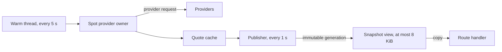

# Price snapshot

This document describes `GET /v1/prices/snapshot`, a small, shared, cached list of USD prices for the six core coins that every wallet shows first. It covers the API, how the snapshot is produced and bounded, how it is stored, and a load test for it. Client authors, operators who enable the route and developers who work on `src/prices/price_snapshot.cpp` need it.

## Enabling

`FORTIS_PRICE_SNAPSHOT_ENABLED=1` enables the route. It requires `FORTIS_NATIVE_PRICE_ROUTE_CANARY=1` and a valid `FORTIS_CA_BUNDLE_PATH`. The default is off.

The six core coins are `bitcoin`, `ethereum`, `binancecoin`, `ripple`, `solana` and `algorand` ([src/prices/price_core_ids.h](../src/prices/price_core_ids.h)).

## API

```
GET /v1/prices/snapshot
Authorization: Bearer <device token>
Accept: application/json
If-None-Match: "px1-<previous version>"
```

- The route takes no query parameters and answers only in JSON. Another requested representation gets `406`.
- `GET` and `HEAD` apply the same device authorization, attestation policy and quota as spot prices. A request costs one quota unit, also when the answer is `304`.
- Responses carry `Cache-Control: private, no-cache` and `Vary: Accept`. Errors carry `no-store`. The response may not be stored by a shared cache and contains no address data.
- Without a valid snapshot the route answers `503` `SNAPSHOT_NOT_READY` with `Retry-After`.

A `200` body contains `schemaVersion: 1`, `fiat: "usd"`, `quotes`, `missing` and `coverage: {available, requested}`. Each quote has:

| Field | Meaning |
| --- | --- |
| `id` | Coin ID |
| `price` | Positive finite USD price |
| `source` | Provider that supplied the quote |
| `cacheAsOfMs` | Timestamp of the cache entry. It is not the provider's observation time |
| `receivedAtMs` | When the node received the quote, or null if unknown |
| `providerObservedAtMs` | When the provider observed the price, or null if the provider did not say |
| `freshUntilMs` | End of the cache freshness period |
| `stale` | True after `freshUntilMs`, or when the provider observation is older than five minutes |

How to use the fields:

- Compute age from the absolute timestamps and the client's clock. The body contains no relative age.
- A provider observation can be older than the receipt by the node. Cache freshness is not provider freshness.
- A coin without a usable price is listed in `missing`. A price is never zero.
- Last-known values that are older than the cache's seven-day limit are not included.

The `ETag` identifies the serialized bytes. It stays the same across rebuilds while quotes and coverage are unchanged. It changes when a quote changes, when a quote turns from fresh to stale and when a quote becomes missing.

## How the snapshot is produced



- **Warm thread.** Every five seconds it asks the shared spot owner to refresh the six core coins when they are within 20 seconds of expiry. It uses the same provider lanes, fallbacks and deadlines as foreground spot requests.
- **Publisher.** Every second, and at each quote's expiry time, it reads the six cache entries and builds a complete, immutable generation of at most 8 KiB.
- **View.** It accepts a generation only if it is newer than the current one, not dated in the future and not expired. At each quote's freshness deadline the view sets that quote's `stale` flag and changes the `ETag` itself, without waiting for the publisher. The last accepted generation stays available until its hard expiry.
- **Route handler.** It authorizes the device and copies the bytes of the current generation. It never reads the price store and holds no provider credentials. It cannot start a refresh.

Further properties:

- The route does not run under the global route lock.
- Snapshot and spot reads share one cache of successful authorizations when `FORTIS_SPLIT_PRICE_STORE=1`. An entry lives 30 seconds. Expiry and attestation are checked on every hit, and rotation and revocation invalidate the entry.
- The reply is written with a short deadline and does not use the response handoff.
- On shutdown the publisher is joined before the stores are closed.
- `/statusz` reports readiness, the generation sequence, the age of the current generation and the number of requests that found no generation.

For comparison, a spot request (`GET /v1/prices`) answers cached batches directly and queues stale IDs for background refresh. When it needs a provider, the spot owner has four seconds to answer and the response handoff has five.

## Storage

The stored quote format and the spot API bodies are the same with and without the snapshot.

When a provider supplies an observation time (CoinGecko's `last_updated_at` for simple prices, requested for USD when the snapshot is enabled, or `last_updated` for markets), the node stores it in a separate metadata record, `price/spot/meta/v1/<fiat>/<id>`, in the same storage frame as the quote and the price series.

- A metadata record is written only for a valid supplied time, never for a negative answer. A time is never invented.
- The record embeds the exact quote record and a checksum. A concurrent, partial or out-of-order write therefore cannot attach metadata to the wrong quote.
- Ordinary spot lookups do not read metadata. Snapshot lookups do.
- The records expire. A release that does not know them ignores them.
- A full frame of quotes, series and metadata holds at most 900 mutations.

## Tests

- `price_snapshot_test`, `price_spot_cache_test`, `price_provider_batch_test`, `coingecko_price_test` and `native_config_test` are part of `make test`.
- `python3 tests/price_core_warmer_test.py build/coin_popularity_fixture` checks the warm cache and refresh before expiry against a local TLS server.

Neither needs a real provider or a secret.

## Request statistics

`/stats` shows request counts and latency for the last 15 minutes by HTTP method and route, and a breakdown by operating system of the enrolled devices. The page loads `/statsz`. It shows histogram estimates of p50, p95 and p99, queue time inside the node and rejection counters since start. The data is held in bounded memory and is lost at restart. It contains no URLs, tokens, addresses or device IDs. See [node-dashboard.md](node-dashboard.md).

## Simulate 100 Portfolio opens

`tests/portfolio_load_test.py` measures the price routes as 100 wallets opening their portfolio screen at once. Run it from the repository root against a node in development attestation mode, with the snapshot enabled:

```sh
python3 -B tests/portfolio_load_test.py --base-url http://127.0.0.1:8080 \
  --users 100 --mode mixed --require-snapshot --warmup > portfolio-load.json
```

What it does:

1. It enrolls 100 separate devices through the protobuf challenge and enrollment routes. These routes share a quota of 10 requests per address per minute, so the tool enrolls five devices a minute and setup takes about 19 minutes.
2. With `--warmup` it checks, with an already enrolled device, that all prices are available just before the measurement. Warm-up requests are reported separately. Without the flag the run is cold and can correctly see incomplete contract coverage while refreshes finish. A failed warm-up fails the run.
3. It releases one burst of 100 simultaneous portfolio opens.
4. It revokes all credentials. Tokens are kept in memory only.

Options:

| Option | Effect |
| --- | --- |
| `--mode mixed` | Each open sends the snapshot request and a protobuf spot request in parallel, with six core coins and six contract IDs |
| `--mode snapshot`, `--mode spot` | Only the snapshot, or only the spot request |
| `--require-snapshot` | Fail on a snapshot error or on incomplete fresh coverage. Without it, the run checks that the spot request covers for a failed snapshot |
| `--conditional` | Also test revalidation with `If-None-Match` |
| `--rounds N --interval S` | Repeat the burst with the same devices |
| `--max-core-p95-ms N` | Fail above a latency budget |
| `--core-deadline-ms N --min-core-success-percent P` | Count failed, stale, incomplete and slow opens against one deadline |
| `--users 5` | A quick check of the target |
| `--allow-remote` | Required for an HTTPS target that is not on loopback |
| `--ca-file` | CA bundle for a private development node |

The JSON report contains p50, p95, p99 and maximum latency, counts of statuses and errors including 429, body sizes, throughput, and the time from the start of the burst until each device has one and all six core prices. It checks the returned prices; HTTP 200 alone does not count as success. Enrollment and revocation are reported separately from read latency.

Enrollment retries only on `429`, for at most two extra quota windows, and records every attempt. Another probe from the same address uses the same quota, so do not run one during setup.

Limits of this test: one client machine opens a new connection for every request. The test measures the price path. It does not measure application start, blockchain balances or traffic from many networks.
