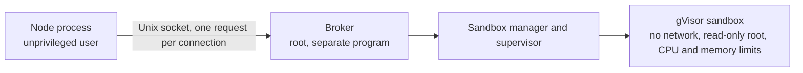

# Sandboxed workloads: the node's control client

A Linux host can run bounded workloads in gVisor sandboxes next to the node. This document describes the part of that system that is in this repository: the client with which the node asks a local broker to start, inspect and stop a job. Developers who change `src/compat/sandbox_socket.cpp` or `src/operations/sandbox_control.cpp`, and operators who connect a node to a sandbox broker, need it.

The sandbox manager itself is not in this repository. The `fortis-sandbox` program (manager, supervisor and broker), its installation policy, its service templates and the gVisor packaging are in the [`sandbox/` directory of FortisNet Node OS](https://github.com/FortisNet/node-os/tree/main/sandbox). Provisioning a host, resource limits, isolation settings and job records are documented there.

## Boundaries



- The node stays unprivileged. It needs no root, `sudo`, setuid program, container runtime socket or extra Linux capability. It needs only access to one Unix socket.
- The node has **no public HTTP route** that starts, inspects or stops a workload. The client is a local command of the node executable and a C++ function.
- The broker decides what may run. A request names an approved image, arguments and resource requirements. It cannot select the runtime, enable networking, mount host files, pass environment variables or attach devices.
- The broker authorizes one host user. It is not a boundary between tenants: every process that runs as the node's user is trusted equally. Do not expose the client to public requests, and do not run workloads as the node's user.
- The client works only on Linux. On other platforms it refuses every request.

## Authenticated local node control

### Command

The node executable handles the `sandbox` command before it starts anything else. It does not load the server configuration or open the store.

```sh
fortis-node sandbox SOCKET start SPEC.json
fortis-node sandbox SOCKET status JOB_ID
fortis-node sandbox SOCKET stop JOB_ID
```

`SOCKET` is the absolute path of the broker's socket, for example `/run/fortis-sandbox/node.sock`. In a development checkout the program is `build/fortis_node`.

`SPEC.json` must be a regular file, not a symbolic link, of at most 16 KiB. The node sends its bytes unchanged; the broker validates the schema.

The command prints the broker's reply, one JSON object, on standard output.

| Exit code | Meaning |
| --- | --- |
| 0 | The broker answered `ok` or `accepted` |
| 1 | The broker refused the request |
| 2 | Local failure: wrong arguments, unreadable spec, failed authentication, transport error or timeout. The message on standard error is fixed and names no paths or arguments |

### Authentication

No secret is stored or sent. Both sides rely on credentials that the kernel reports.

Before the client sends anything, it checks that:

1. the socket path is absolute and normalized;
2. `/` and every parent directory of the socket are owned by root and not writable by group or others;
3. the socket is a socket, has mode `0600` and is owned by the user the node runs as;
4. the process at the other end runs as root, according to `SO_PEERCRED`.

The broker in turn reads the client's user ID from `SO_PEERCRED` and serves only the user it was started for.

These credentials are taken when the connection is made. They identify a user, not a program.

When the node runs in a container, mount the directory that contains the socket, read-only, not the socket file: a mount of the file would keep pointing at the old socket after the broker restarts. The node's user ID must be the same inside and outside the container, so user-namespace remapping does not work with this scheme.

### Protocol

One connection carries one request and one reply ([src/codec/sandbox_wire.h](../src/codec/sandbox_wire.h)).

| Part | Format |
| --- | --- |
| Header | 12 bytes: `FSB1`, direction (0 request, 1 reply), code, two reserved zero bytes, body length as a 32-bit big-endian integer |
| Request code | 1 start, 2 status, 3 stop |
| Request body | For start, the job specification, at most 16 KiB. For status and stop, the job ID, at most 48 bytes |
| Reply body | One JSON object, at most 8 KiB |

The client sends header and body, closes its sending side, reads the reply and requires the broker to close without further bytes. The whole exchange has one deadline of five seconds; interrupted and partial reads do not extend it. A wrong magic value, direction, reserved byte, code or length ends the exchange with an error.

Reply codes:

| Code | Name | Meaning |
| --- | --- | --- |
| 0 | `ok` | The request succeeded |
| 1 | `accepted` | A durable job record exists. The job is not necessarily running or successful |
| 2 | `not_found` | No such job, or the job belongs to another owner |
| 3 | `conflict` | The job ID exists with a different specification |
| 4 | `denied` | The caller is not authorized |
| 5 | `busy` | No capacity |
| 6 | `bad_request` | The request is invalid |
| 7 | `unavailable` | The broker cannot serve the request now |

### Using it correctly

- **Start is idempotent.** Repeating a start with the same job ID and the same specification returns the existing result. The same ID with another specification is a conflict. A finished job ID is never run again.
- **A lost reply is ambiguous.** The client does not retry. After a timeout the job may have been accepted. Send the same ID and specification again, or ask for the status. Do not invent a new ID.
- **Stop requests cancellation.** Poll the status until the job is in a final state before assuming that its resources are free.
- **Replies are sanitized.** They contain job state and resource figures, not arguments, private paths or workload output.

### C++ interface

`fortis::compat::sandbox::Request` ([src/compat/sandbox_socket.h](../src/compat/sandbox_socket.h)) performs one exchange and returns the reply code and the JSON payload. It borrows its inputs only for the duration of the call and owns the reply. It is synchronous and safe to call from several threads at once, because each call uses its own connection. It throws on authentication, transport and protocol failures.

## Tests

`build/sandbox_ipc_test` is part of `make test`. It covers the header encoding and its bounds, partial and interrupted I/O, moving a descriptor between owners, peer identity, the shared deadline with slow and short peers, refusal of trailing data and sending to a closed peer.

The tests that run real workloads against a broker and gVisor are in FortisNet Node OS.
